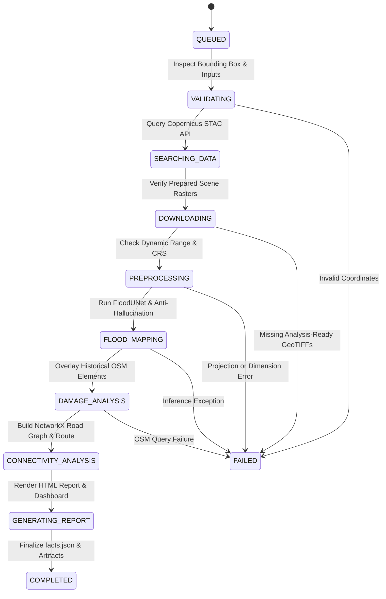

# FloodSight AI — Multimodal Earth Observation & Disaster Intelligence Platform

[](https://www.python.org/)
[](https://pytorch.org/)
[](https://rasterio.readthedocs.io/)
[](https://networkx.org/)
[](LICENSE)
[](tests/)

> **Rapid-response spaceborne flood inundation mapping, debris candidate detection, road network connectivity analysis, downstream flood-path tracing, and executive situation reporting powered by dual-polarization Sentinel-1 SAR and OpenStreetMap.**

---

## Table of Contents

- [1. Executive Overview](#1-executive-overview)
- [2. System Architecture](#2-system-architecture)
- [3. Technology Stack](#3-technology-stack)
- [4. Repository & Project Layout](#4-repository--project-layout)
- [5. Core Methodologies & Mathematical Formulation](#5-core-methodologies--mathematical-formulation)
  - [5.1 Deep Learning Segmentation (`FloodUNet`)](#51-deep-learning-segmentation-floodunet)
  - [5.2 Tri-Partite Composite Loss (`ComboLoss`)](#52-tri-partite-composite-loss-comboloss)
  - [5.3 Multi-Stage Physics Anti-Hallucination Pipeline](#53-multi-stage-physics-anti-hallucination-pipeline)
  - [5.4 Class B: Debris Candidate & Surface Change Detection](#54-class-b-debris-candidate--surface-change-detection)
  - [5.5 Topological Road Graph & Cut-Off Routing](#55-topological-road-graph--cut-off-routing)
  - [5.6 Hydrological Downstream Flood-Path Analysis (DEM)](#56-hydrological-downstream-flood-path-analysis-dem)
  - [5.7 Clear-Sky Optical Cross-Validation (Sentinel-2 NDWI)](#57-clear-sky-optical-cross-validation-sentinel-2-ndwi)
- [6. 10-State Pipeline Execution Lifecycle](#6-10-state-pipeline-execution-lifecycle)
- [7. Installation & Quickstart](#7-installation--quickstart)
  - [7.1 Environment Setup](#71-environment-setup)
  - [7.2 Data Preparation (KuroSiwo Dataset)](#72-data-preparation-kurosiwo-dataset)
  - [7.3 Model Training & Validation](#73-model-training--validation)
  - [7.4 Asynchronous Worker Execution](#74-asynchronous-worker-execution)
  - [7.5 End-to-End Master Pipeline](#75-end-to-end-master-pipeline)
  - [7.6 Independent Holdout Benchmarking](#76-independent-holdout-benchmarking)
- [8. Output Artifacts & `facts.json` Specification](#8-output-artifacts--factsjson-specification)
- [9. Testing & Quality Assurance](#9-testing--quality-assurance)
- [10. Data Integrity, Attributions & Ethical Disclaimers](#10-data-integrity-attributions--ethical-disclaimers)

---

## 1. Executive Overview

During severe monsoon rains and extreme weather disasters (such as the Trishuli and Bhote Koshi flash floods in the Nepal Himalayas), persistent cloud cover and deep mountain gorges render conventional optical satellite imagery ineffective. **FloodSight AI** addresses this operational crisis by utilizing spaceborne **Synthetic Aperture Radar (SAR)** from the **Sentinel-1** constellation, which operates at C-band microwave frequencies (5.405 GHz) to penetrate clouds, monsoon precipitation, smoke, and nighttime darkness.

### Key Capabilities
* **All-Weather Dual-Polarization SAR Inundation Mapping:** Ingests Sentinel-1 VV (vertical transmit/receive) and VH (cross-polarization) radar backscatter in decibels ($\text{dB}$) to delineate smooth specular floodwaters.
* **Lightweight Custom Neural Network (`FloodUNet`):** A custom 1.63M parameter U-Net architecture trained completely from scratch without external pre-trained backbones, optimized for sub-4GB VRAM and rapid field execution.
* **Physics-Grounded Anti-Hallucination Filters:** Suppresses radar layover, mountain shadow, and permanent water misclassifications using temporal change consistency, temperature scaling, calibrated confidence thresholds, and morphological speckle cleaning.
* **Class B Debris & Valley Change Detection:** Detects radar roughness increases ($\Delta\text{dB} \ge +2.0\text{ dB}$) in valley corridors to map post-flood boulder, mud, and gravel deposits.
* **Topological Road Graph Connectivity Routing:** Builds an OpenStreetMap (OSM) highway network in NetworkX, removes severed roads and bridges, and classifies settlements into `CONNECTED`, `CUT_OFF`, or `UNKNOWN`.
* **DEM Downstream Flow-Path Tracing:** Computes D8 steepest-descent hydraulic flow vectors over Copernicus WorldDEM-30 to project downriver flood progression corridors and downstream communities at risk.
* **Actionable Emergency Outputs:** Emits a cryptographically verified single-source-of-truth metadata file (`facts.json`), a print-ready 1-page executive HTML situation report, and an interactive Leaflet web dashboard.

---

## 2. System Architecture

The following diagram illustrates the complete end-to-end data flow, deep learning inference, geospatial intelligence processing, and delivery pipelines:

```mermaid
%% Generated by https://gitdiagram.com/venu-822006/multimodal-ai
flowchart TD

subgraph group_orchestration["Job orchestration"]
  node_worker["Job worker<br/>[worker.py]"]
  node_stac["Scene search<br/>[stac_search.py]"]
end

subgraph group_modeling["Model lifecycle"]
  node_dataset["Training dataset<br/>[dataset.py]"]
  node_trainer["Model training<br/>[train.py]"]
  node_unet["U-Net model<br/>[model.py]"]
  node_baseline["Baseline mapping<br/>[baseline.py]"]
end

subgraph group_analysis["Flood analysis"]
  node_predict["Flood inference<br/>[predict.py]"]
  node_floodmask["Flood mask and facts<br/>[predict.py]"]
  node_debris["Debris candidates<br/>[debris.py]"]
  node_optical["Optical verification"]
end

subgraph group_impact["Impact assessment"]
  node_damage["Exposure analysis<br/>[damage_analysis.py]"]
  node_connectivity["Road connectivity"]
  node_osm[("OSM snapshot<br/>[worker.py]")]
end

subgraph group_outputs["Results and review"]
  node_evaluation["Mask evaluation<br/>[evaluate.py]"]
  node_caseeval["EMSR927 check"]
  node_report["Situation report<br/>[generate_report.py]"]
  node_dashboard["Map dashboard"]
  node_outputs["Job outputs"]
end

node_user(("Analyst"))
node_ohsome{{"ohsome service"}}
node_prepared["Prepared scenes"]

node_user -->|"starts job"| node_worker
node_user -->|"trains model"| node_trainer
node_user -->|"evaluates holdout"| node_evaluation
node_user -->|"checks reference"| node_caseeval
node_worker -->|"searches metadata"| node_stac
node_worker -->|"fetches snapshot"| node_ohsome
node_ohsome -.->|"returns features"| node_osm
node_prepared -->|"provides scenes"| node_worker
node_trainer -->|"loads samples"| node_dataset
node_trainer -->|"trains model"| node_unet
node_worker -->|"runs inference"| node_predict
node_predict -->|"loads checkpoint"| node_unet
node_predict -->|"writes results"| node_floodmask
node_worker -->|"runs analysis"| node_debris
node_worker -->|"runs verification"| node_optical
node_worker -->|"runs analysis"| node_damage
node_worker -->|"runs analysis"| node_connectivity
node_worker -->|"generates report"| node_report
node_worker -->|"generates dashboard"| node_dashboard
node_worker -->|"writes job files"| node_outputs
node_evaluation -->|"writes metrics"| node_outputs
node_caseeval -->|"writes benchmark"| node_outputs
node_baseline -.->|"produces mask"| node_floodmask

click node_worker "https://github.com/venu-822006/multimodal-ai/blob/main/worker.py"
click node_stac "https://github.com/venu-822006/multimodal-ai/blob/main/stac_search.py"
click node_dataset "https://github.com/venu-822006/multimodal-ai/blob/main/dataset.py"
click node_trainer "https://github.com/venu-822006/multimodal-ai/blob/main/train.py"
click node_unet "https://github.com/venu-822006/multimodal-ai/blob/main/model.py"
click node_baseline "https://github.com/venu-822006/multimodal-ai/blob/main/baseline.py"
click node_predict "https://github.com/venu-822006/multimodal-ai/blob/main/predict.py"
click node_floodmask "https://github.com/venu-822006/multimodal-ai/blob/main/predict.py"
click node_debris "https://github.com/venu-822006/multimodal-ai/blob/main/debris.py"
click node_optical "https://github.com/venu-822006/multimodal-ai/blob/main/optical_analysis.py"
click node_damage "https://github.com/venu-822006/multimodal-ai/blob/main/damage_analysis.py"
click node_connectivity "https://github.com/venu-822006/multimodal-ai/blob/main/connectivity_analysis.py"
click node_osm "https://github.com/venu-822006/multimodal-ai/blob/main/worker.py"
click node_evaluation "https://github.com/venu-822006/multimodal-ai/blob/main/evaluate.py"
click node_caseeval "https://github.com/venu-822006/multimodal-ai/blob/main/case_study_emsr927.py"
click node_report "https://github.com/venu-822006/multimodal-ai/blob/main/generate_report.py"
click node_dashboard "https://github.com/venu-822006/multimodal-ai/blob/main/generate_dashboard.py"

classDef toneNeutral fill:#f8fafc,stroke:#334155,stroke-width:1.5px,color:#0f172a
classDef toneBlue fill:#dbeafe,stroke:#2563eb,stroke-width:1.5px,color:#172554
classDef toneAmber fill:#fef3c7,stroke:#d97706,stroke-width:1.5px,color:#78350f
classDef toneMint fill:#dcfce7,stroke:#16a34a,stroke-width:1.5px,color:#14532d
classDef toneRose fill:#ffe4e6,stroke:#e11d48,stroke-width:1.5px,color:#881337
classDef toneIndigo fill:#e0e7ff,stroke:#4f46e5,stroke-width:1.5px,color:#312e81
classDef toneTeal fill:#ccfbf1,stroke:#0f766e,stroke-width:1.5px,color:#134e4a
class node_worker,node_stac toneBlue
class node_dataset,node_trainer,node_unet,node_baseline toneAmber
class node_predict,node_floodmask,node_debris,node_optical toneMint
class node_damage,node_connectivity,node_osm toneRose
class node_evaluation,node_caseeval,node_report,node_dashboard,node_outputs,node_user,node_ohsome,node_prepared toneIndigo
```



---

## 3. Technology Stack

FloodSight AI is engineered with modular, production-grade Python libraries, specialized remote sensing drivers, spatial data structures, and lightweight web visualization components.

### 3.1 Core Deep Learning & Computational Frameworks

| Technology | Specification | Functionality & Project Responsibility |
|:---|:---|:---|
| **Python** | `>= 3.10` | Core language runtime powering all training, CLI tools, and background worker threads. |
| **PyTorch (`torch`)** | `>= 2.3.0` | Deep learning framework hosting the custom `FloodUNet` architecture, GPU tensor calculations, mixed-precision autocast, and gradient optimization. |
| **NumPy (`numpy`)** | Latest stable | High-performance N-dimensional array processing, raster slicing, radiometric math, and matrix masks. |
| **SciPy (`scipy`)** | Latest stable | Scientific computing, 2D convolution filters, uniform filters, and image variance modeling for SAR speckle filtering. |

### 3.2 Geospatial, Remote Sensing & Computer Vision

| Technology | Specification | Functionality & Project Responsibility |
|:---|:---|:---|
| **Rasterio (`rasterio`)** | Latest stable | GDAL-backed raster I/O reading/writing georeferenced GeoTIFFs, metadata transforms (`Affine`), coordinate reference systems (`CRS`), and windowed reads. |
| **Shapely (`shapely`)** | Latest stable | Planar geometric engine handling vector geometries, polygon simplification, buffer calculations, and spatial intersections between floods and OSM features. |
| **OpenCV (`opencv-python-headless`)** | Latest stable | Headless image processing for morphological kernels, connected component analysis, speckle cleaning, and contour extraction. |
| **Scikit-Image (`scikit-image`)** | Latest stable | Otsu automated bimodal thresholding (`threshold_otsu`), morphological island removal, and texture entropy analysis. |
| **Albumentations (`albumentations`)** | `>= 1.3, < 2.0` | Spatial data augmentations during training (horizontal/vertical flips, affine transformations, random crops) with strict dual-channel alignment. |
| **PySTAC Client (`pystac-client`)** | `>= 0.8.0` | SpatioTemporal Asset Catalog client querying the Copernicus Data Space Ecosystem (CDSE) for Sentinel-1 and Sentinel-2 granule metadata. |

### 3.3 Graph Theory & Network Routing

| Technology | Specification | Functionality & Project Responsibility |
|:---|:---|:---|
| **NetworkX (`networkx`)** | Latest stable | Graph data structures constructing topological road networks from OSM ways, calculating shortest paths (`dijkstra_path`), and evaluating post-flood hospital reachability. |

### 3.4 Data APIs & Remote Services

| Service / API | Access Method | Functionality & Project Responsibility |
|:---|:---|:---|
| **Copernicus Data Space Ecosystem (CDSE)** | STAC API / HTTPS | Discovery of Sentinel-1 C-band SAR GRD scenes and Sentinel-2 L2A optical granules across orbit passes. |
| **Heidelberg ohsome API** | REST API (`/elements/geometry`) | Extraction of dated, pre-event OpenStreetMap snapshots (buildings, roads, bridges, settlements, healthcare facilities) to prevent post-disaster mapping bias. |
| **Copernicus WorldDEM-30** | GeoTIFF / Synthetic Fallback | 30-meter spatial elevation model driving slope filtering and D8 steepest-descent flow direction calculations. |

### 3.5 Visualization, Reporting & Interface

| Technology | Specification | Functionality & Project Responsibility |
|:---|:---|:---|
| **Leaflet.js** | CDN (`1.9.4`) | Interactive browser-based map rendering vectorized flood polygons, road lines, critical medical facilities, and cut-off settlement markers. |
| **HTML5 / CSS3** | Native Semantic Standard | Clean, responsive, print-optimized A4 layout for the standalone one-page executive situation report (`situation_report.html`). |

### 3.6 Testing & Code Quality

| Tool | Specification | Functionality & Project Responsibility |
|:---|:---|:---|
| **Pytest (`pytest`)** | `>= 8.0` | Automated unit, regression, and data-rule test runner verifying network shapes, anti-hallucination logic, and terminology compliance. |

---

## 4. Repository & Project Layout

```text
aimodel/
├── .gitignore                   # Git exclusion rules (caches, weights, data)
├── requirements.txt             # Locked Python package dependencies
├── Space Track.pdf              # Technical challenge specification & rubrics
├── README.md                    # Primary project documentation (this file)
├── MODEL_TRAINING.md            # Deep dive into training procedure & parameters
│
├── model.py                     # FloodUNet PyTorch architecture (1.63M params)
├── dataset.py                   # KuroSiwo PyTorch Dataset loader & augmentations
├── train.py                     # Training loop with ComboLoss & early stopping
├── predict.py                   # Inference engine & anti-hallucination filters
├── baseline.py                  # Log-ratio SAR change detection baseline
├── debris.py                    # Class B surface change & debris candidate detector
├── preprocess.py                # Raw Sentinel-1 GRD linear-to-dB conversion & calibration
├── setup_data.py                # KuroSiwo dataset batch downloader & unpacker
│
├── damage_analysis.py           # OSM exposure analysis (buildings, roads, bridges)
├── connectivity_analysis.py      # NetworkX 3-state road graph reachability routing
├── dem_flow_analysis.py          # D8 downstream steepest-descent flow-path tracing
├── optical_analysis.py           # Sentinel-2 NDWI & radar-optical agreement
│
├── generate_report.py           # Printable 1-page executive HTML situation report
├── generate_dashboard.py        # Interactive Leaflet map dashboard generator
├── worker.py                    # Asynchronous 10-state job lifecycle orchestrator
├── run_pipeline.py              # End-to-end master automation pipeline
│
├── evaluate.py                  # Standard segmentation metrics (IoU, F1, Precision, Recall)
├── evaluate_himalayan.py         # Strict unseen Himalayan holdout benchmark
├── case_study_emsr927.py         # Independent EMSR927 Copernicus EMS reference comparison
├── stac_search.py               # Copernicus STAC API scene discovery utility
│
├── checkpoints/                 # Saved model weights, history, & val manifests
│   ├── best.pt                  # Checkpoint with optimal validation flood IoU
│   ├── val_manifest.json        # Serialized held-out validation pairs
│   └── training_history.csv     # Per-epoch loss and metrics log
│
├── data/                        # Local data directory
│   ├── processed/               # Analysis-ready 2-band float32 GeoTIFFs & masks
│   │   ├── images/              # VV/VH dB GeoTIFFs (*_post.tif, *_pre.tif)
│   │   └── masks/               # 1-band uint8 ground truth masks
│   └── osm/                     # Cached GeoJSON snapshots from ohsome
│
├── docs/                        # In-depth architectural & API specifications
│   ├── AI_MODEL_ARCHITECTURE.md # Deep mathematical & layer specification
│   ├── API_REFERENCE.md         # CLI & backend API integration guide
│   ├── CASE_STUDY_EMSR927.md    # EMSR927 reference evaluation guidelines
│   ├── HIMALAYAN_EVALUATION.md  # Himalayan generalization protocol
│   └── TESTING_STRATEGY.md      # Testing matrix & regression criteria
│
├── outputs/                     # Generated job deliverables & artifacts
│   ├── status.json              # Real-time state machine log
│   ├── facts.json               # Canonical computed disaster metrics
│   ├── situation_report.html    # Standalone executive briefing
│   ├── dashboard.html           # Interactive web dashboard
│   └── *.tif                    # Predicted flood & multi-class rasters
│
└── tests/                       # Automated test suite
    ├── test_ai_model.py         # Unit tests for FloodUNet, filters, & algorithms
    └── test_data_rules.py       # Data integrity, leakage, & wording tests
```

---

## 5. Core Methodologies & Mathematical Formulation

### 5.1 Deep Learning Segmentation (`FloodUNet`)

The primary AI segmentation network is implemented in `model.py` as an encoder-decoder architecture initialized from scratch using Kaiming normal distribution (`fan_out`, ReLU).

* **Input Layer:** 2 channels ($C=2$):
  - Band 1: Sentinel-1 VV backscatter ($\sigma^0_{\text{dB}}$)
  - Band 2: Sentinel-1 VH backscatter ($\sigma^0_{\text{dB}}$)
* **Encoder Pathway:** 4 downsampling stages with double $3 \times 3$ convolutions, Batch Normalization, and ReLU activations:
  $$\text{Stage 1: } 2 \to 24 \quad | \quad \text{Stage 2: } 24 \to 48 \quad | \quad \text{Stage 3: } 48 \to 96 \quad | \quad \text{Bottleneck: } 96 \to 192$$
* **Decoder Pathway:** 3 upsampling stages via transposed convolutions ($2 \times 2$, stride 2) with skip-connections concatenated along channels:
  $$\text{Stage 3: } 192 \to 96 \quad | \quad \text{Stage 2: } 96 \to 48 \quad | \quad \text{Stage 1: } 48 \to 24$$
* **Bilinear Interpolation Guard:** Automatically resolves off-by-one spatial dimension mismatches during skip concatenation for odd-sized inputs (e.g. $225 \times 225$).
* **Segmentation Head:** $1 \times 1$ convolution mapping 24 features to 2 logits: Class 0 (Background / Dry Land) and Class 1 (Inundated Water).
* **Footprint:** ~1.63M parameters (~13 MB checkpoint), ensuring execution on modest edge GPUs (such as NVIDIA RTX 3050).

---

### 5.2 Tri-Partite Composite Loss (`ComboLoss`)

In global flood datasets, water pixels comprise only **~2.02%** of typical SAR scenes (a ~50:1 class imbalance). Standard Cross-Entropy collapses into trivial background predictions. FloodSight AI combats this using a composite loss:

$$\mathcal{L}_{\text{total}} = 0.35 \cdot \mathcal{L}_{\text{wCE}} + 0.35 \cdot \mathcal{L}_{\text{Focal}} + 0.30 \cdot \mathcal{L}_{\text{Dice}}$$

1. **Weighted Cross-Entropy ($\mathcal{L}_{\text{wCE}}$):**
   Inverse frequency weighting ($w_{\text{bg}} = 1.0, w_{\text{flood}} = 49.5$) penalizes missed flood pixels heavily.
2. **Focal Loss ($\mathcal{L}_{\text{Focal}}$):**
   Down-weights easy background negatives and focuses gradient updates on ambiguous land-water boundaries ($\gamma = 2.0$):
   $$\mathcal{L}_{\text{Focal}} = -\alpha_t (1 - p_t)^\gamma \log(p_t)$$
3. **Soft Dice Loss ($\mathcal{L}_{\text{Dice}}$):**
   Directly optimizes regional spatial overlap (differentiable IoU surrogate):
   $$\mathcal{L}_{\text{Dice}} = 1 - \frac{2 \sum (p_{\text{flood}} \cdot y_{\text{flood}}) + \epsilon}{\sum p_{\text{flood}} + \sum y_{\text{flood}} + \epsilon}$$

---

### 5.3 Multi-Stage Physics Anti-Hallucination Pipeline

SAR segmentation in mountainous terrain is prone to false positives caused by radar shadow, layover, and dark tarmac surfaces. FloodSight AI incorporates a multi-tier suppression filter (`predict.py`):

1. **Temperature Scaling:** Raw logits are calibrated using $\tau = 1.5$ to prevent peak softmax overconfidence:
   $$p_i = \frac{\exp(z_i / \tau)}{\sum_j \exp(z_j / \tau)}$$
2. **Calibrated Softmax Thresholding:** Rejects marginal predictions with probability $p < 0.55$.
3. **Temporal Change Consistency Check:** When a pre-flood SAR image is available, pixels must demonstrate a genuine backscatter drop caused by specular reflection off open water:
   $$\Delta\text{dB} = \text{dB}_{\text{pre}} - \text{dB}_{\text{post}} \ge 1.5\text{ dB}$$
   Permanent water bodies, wet rice paddies, and static radar shadows ($\Delta\text{dB} \approx 0$) are rejected.
4. **Morphological Speckle Cleaning:** Eliminates isolated false-positive speckle clusters ($< 20\text{ pixels}$) and fills interior holes in solid flood bodies.

---

### 5.4 Class B: Debris Candidate & Surface Change Detection

Floods in steep mountain valleys transport boulders, silt, and heavy mud. Rather than becoming specular reflectors (which reduce backscatter), debris deposits introduce high surface roughness that **increases** radar backscatter:

$$\Delta\text{dB}_{\text{debris}} = \text{dB}_{\text{post}} - \text{dB}_{\text{pre}} \ge +2.0\text{ dB}$$

When detected inside valley corridors, these are flagged as **Class B: Possible Debris / Surface Change** (experimental, confidence $0.40 - 0.75$) and assigned pixel value `2` in multi-class outputs.

---

### 5.5 Topological Road Graph & Cut-Off Routing

Implemented in `connectivity_analysis.py`, this module models critical infrastructure accessibility:

1. **Graph Construction:** Builds a graph $G = (V, E)$ from OpenStreetMap highway ways (`primary`, `secondary`, `tertiary`, `trunk`).
2. **Pre-Disaster Baseline:** Computes shortest topological driving paths from each village/town node to the nearest hospital hub via Dijkstra's algorithm.
3. **Flood Severance:** Intersects the road network with the validated flood polygon (buffered by 15m) and removes severed edges.
4. **3-State Re-Routing Assessment:**
   * **`CONNECTED`:** An alternative overland road route to the medical hub remains accessible.
   * **`CUT_OFF`:** A valid route existed before the flood, but all paths are now severed.
   * **`UNKNOWN`:** No route existed pre-event, or nodes lacked mapped highway connectivity.

---

### 5.6 Hydrological Downstream Flood-Path Analysis (DEM)

Implemented in `dem_flow_analysis.py`, this module analyzes downstream risks along mountain river corridors:

* **D8 Steepest Descent:** Calculates steepest slope direction from Copernicus WorldDEM-30 elevation grids across 8 adjacent neighbor cells:
  $$\text{Slope}_i = \frac{z_{\text{center}} - z_i}{d_i}$$
* **Downriver Propagation Vectors:** Traces hydraulic flow vectors originating from mapped flood footprints along canyon floors.
* **Corridor Metrics:** Computes downstream propagation distance ($\text{km}$), total elevation drop ($\text{m}$), and hydraulic gradient ($\text{m/km}$), highlighting communities downstream of active flood surges.

---

### 5.7 Clear-Sky Optical Cross-Validation (Sentinel-2 NDWI)

Implemented in `optical_analysis.py`, this module supports multi-sensor validation when clear-sky Sentinel-2 optical imagery is available:

$$\text{NDWI} = \frac{\rho_{\text{Green}} - \rho_{\text{NIR}}}{\rho_{\text{Green}} + \rho_{\text{NIR}} + 10^{-6}} \quad (\text{Band 3 vs Band 8})$$

* **Cloud Screening:** Excludes optical pixels obscured by clouds using top-of-atmosphere reflectance thresholds.
* **Cross-Sensor Agreement:** Classifies pixels into *Confirmed Water* (both SAR and optical agree), *Radar-Only* (detected under clouds/spray), or *Optical-Only* (shallow surface moisture).

---

## 6. 10-State Pipeline Execution Lifecycle

The asynchronous pipeline (`worker.py`) executes through a formal 10-state lifecycle, emitting real-time telemetry to `status.json` and `job.log`:



| State Code | Phase Description | Key Actions & Invariants |
|:---|:---|:---|
| `QUEUED` | Job Registration | Allocates unique `job_id`, initializes workspace and logs. |
| `VALIDATING` | Parameter Verification | Checks coordinate bounds ($-180 \le \lambda \le 180$, $-90 \le \phi \le 90$, $\text{west} < \text{east}$). |
| `SEARCHING_DATA` | STAC Catalog Search | Discovers relative-orbit matching Sentinel-1 pre/post acquisitions. |
| `DOWNLOADING` | Input Verification | Verifies caller-supplied two-band VV/VH dB GeoTIFFs exist. |
| `PREPROCESSING` | Radiometric Validation | Ensures EPSG:4326 CRS, identical spatial grids, and physical dB dynamic range. |
| `FLOOD_MAPPING` | Deep Learning Inference | Executes `FloodUNet`, temperature scaling, temporal filtering, and speckle removal. |
| `DAMAGE_ANALYSIS` | OSM Exposure Assessment | Intersects flood footprint with pre-event buildings, roads, and bridges. |
| `CONNECTIVITY_ANALYSIS` | Road Network Routing | Evaluates 3-state settlement access (`CONNECTED`, `CUT_OFF`, `UNKNOWN`) via NetworkX. |
| `GENERATING_REPORT` | Briefing & Map Assembly | Generates `situation_report.html` and interactive `dashboard.html`. |
| `COMPLETED` | Execution Success | Writes validated `facts.json` containing all metrics. |
| `FAILED` | Graceful Error Handling | Records error diagnostics into `status.json` without silent crashes. |

---

## 7. Installation & Quickstart

### 7.1 Environment Setup

Python 3.10 or later is required. Set up a virtual environment and install the required dependencies:

```powershell
# Clone the repository
git clone https://github.com/your-org/aimodel.git
cd aimodel

# Create and activate virtual environment
python -m venv venv
.\venv\Scripts\Activate.ps1   # On Linux/macOS: source venv/bin/activate

# Install dependencies
python -m pip install --upgrade pip
python -m pip install -r requirements.txt
```

---

### 7.2 Data Preparation (KuroSiwo Dataset)

FloodSight AI trains on the benchmark **KuroSiwo** Sentinel-1 flood dataset. Use `setup_data.py` to download and convert raw patches into analysis-ready GeoTIFFs:

```powershell
# Download Batch 0 and unpack into analysis-ready GeoTIFFs
python setup_data.py

# Or convert an already downloaded raw directory:
python setup_data.py --skip-download --raw-dir data/raw/batch0
```

This organizes the dataset into:
* `data/processed/images/`: 2-band float32 GeoTIFFs (Band 1: VV dB, Band 2: VH dB).
* `data/processed/masks/`: 1-band uint8 GeoTIFFs (`0` = background, `1` = flood, `255` = nodata).

---

### 7.3 Model Training & Validation

Train `FloodUNet` from scratch with event-held-out validation:

```powershell
python train.py --data-dir data/processed --output-dir checkpoints `
    --epochs 100 --patience 15 --batch-size 4 --patch-size 224
```

* **Early Stopping:** Monitored on held-out validation flood IoU (patience: 15 epochs).
* **Outputs:** Serialized weights (`checkpoints/best.pt`), validation manifest (`checkpoints/val_manifest.json`), and metrics history (`checkpoints/training_history.csv`).

---

### 7.4 Asynchronous Worker Execution

To run an operational job over prepared pre- and post-flood Sentinel-1 scenes:

```powershell
python worker.py --bbox 85.1 27.8 85.5 28.1 --flood-date 2026-08-26 `
    --pre-image data/scenes/trishuli_pre.tif `
    --post-image data/scenes/trishuli_post.tif `
    --job-id trishuli_demo --out-dir outputs/trishuli
```

*Optional clear-sky Sentinel-2 optical bands:* Add `--s2-green data/scenes/s2_green.tif --s2-nir data/scenes/s2_nir.tif`.

---

### 7.5 End-to-End Master Pipeline

Run the full end-to-end automation pipeline (validation, training, held-out inference, debris detection, and metric aggregation):

```powershell
python run_pipeline.py --epochs 50 --patience 10 --batch-size 4
```

---

### 7.6 Independent Holdout Benchmarking

#### Strict Unseen Himalayan Generalization Benchmark
```powershell
python evaluate_himalayan.py --manifest checkpoints/val_manifest.json `
    --checkpoint checkpoints/best.pt --out-dir outputs/himalayan_eval
```

#### Independent EMSR927 Copernicus EMS Reference Benchmark
```powershell
python case_study_emsr927.py --pred outputs/trishuli/trishuli_demo_flood_predicted.tif `
    --reference data/evaluation_only/emsr927_reference.tif `
    --out-json outputs/emsr927_benchmark_results.json
```

> **Evaluation Protocol Notice:** External reference products (such as EMSR927 or UNOSAT) are strictly for post-hoc validation. They are never used as training inputs, threshold targets, or tuning labels.

---

## 8. Output Artifacts & `facts.json` Specification

Every execution writes a self-contained deliverable bundle to `--out-dir`:

* `*_flood_predicted.tif`: Georeferenced uint8 raster (`0` = dry land, `1` = flood, `255` = nodata).
* `*_multiclass_mask.tif`: Georeferenced uint8 raster (`0` = background, `1` = core flood, `2` = Class B debris).
* `facts.json`: Canonical machine-readable metrics consumed by reporting modules.
* `situation_report.html`: Print-ready A4 executive disaster briefing.
* `dashboard.html`: Interactive Leaflet web application with layer toggles.

### Canonical `facts.json` Schema

```json
{
  "flood_area_km2": 45.67,
  "flood_pixel_count": 456700,
  "total_valid_pixels": 1200000,
  "flood_fraction": 0.3805,
  "bbox": [85.1, 27.8, 85.5, 28.1],
  "crs": "EPSG:4326",
  "pixel_resolution_approx_m": 10.0,
  "checkpoint": "best.pt",
  "val_flood_iou": 0.684,
  "anti_hallucination_metrics": {
    "raw_candidates": 9960,
    "slope_hallucinations_filtered": 2100,
    "temporal_false_positives_filtered": 1800,
    "speckle_noise_pixels_filtered": 1540,
    "verified_flood_pixels": 4520
  },
  "buildings_affected": 142,
  "road_length_affected_km": 18.4,
  "bridges_affected": 3,
  "settlement_counts": {
    "CONNECTED": 12,
    "CUT_OFF": 4,
    "UNKNOWN": 1
  },
  "settlements": [
    {
      "name": "Khopasi Village",
      "state": "CUT_OFF",
      "target": "Dhulikhel Hospital",
      "pre_distance_km": 14.2
    }
  ],
  "downstream_analysis": {
    "propagation_length_km": 12.8,
    "elevation_drop_m": 420.0,
    "hydraulic_gradient_m_per_km": 32.81,
    "downstream_communities_at_risk": 2
  },
  "wording_standard": "Reported counts represent structures/roads affected or potentially affected by mapped inundation."
}
```

---

## 9. Testing & Quality Assurance

FloodSight AI includes an automated regression test suite covering model shapes, filter logic, debris detection, and compliance rules:

```powershell
python -m pytest -v
```

### Verified Test Matrix (14 / 14 Passing)

| Test Suite | Function Name | Target Verification |
|:---|:---|:---|
| `test_ai_model.py` | `test_model_forward_pass_and_shapes` | Standard $256 \times 256$ tensor forward pass & gradient flow. |
| `test_ai_model.py` | `test_model_odd_dimensions_handling` | Bilinear interpolation guard on odd spatial dimensions ($225 \times 225$). |
| `test_ai_model.py` | `test_anti_hallucination_slope_rejection` | Slope filter zeroing out steep terrain ($> 8^{\circ}$). |
| `test_ai_model.py` | `test_anti_hallucination_speckle_filter` | Morphological removal of isolated false-positive speckle ($< 20\text{ px}$). |
| `test_ai_model.py` | `test_anti_hallucination_temporal_filter` | Rejection of permanent water where $\Delta\text{dB} < 1.5\text{ dB}$. |
| `test_ai_model.py` | `test_debris_candidate_detection` | Validation of Class B roughness increase ($\Delta\text{dB} \ge +2.0\text{ dB}$). |
| `test_ai_model.py` | `test_baseline_otsu_thresholding` | Log-ratio baseline Otsu bimodal segmentation convergence. |
| `test_ai_model.py` | `test_optical_ndwi_water_extraction` | McFeeters NDWI computation and cloud screening. |
| `test_ai_model.py` | `test_connectivity_graph_routing` | NetworkX Dijkstra routing and 3-state cut-off classification. |
| `test_ai_model.py` | `test_dem_downstream_flow_path_tracing` | D8 steepest-descent hydraulic vector propagation. |
| `test_ai_model.py` | `test_generate_situation_report_html` | Validation of printable HTML structure and metric bindings. |
| `test_data_rules.py` | `test_no_emsr927_leakage_in_worker_and_training` | Zero references to EMSR927 in core training/worker source files. |
| `test_data_rules.py` | `test_damage_wording_compliance` | Strict enforcement of *"affected / potentially affected"* phrasing. |
| `test_data_rules.py` | `test_mandatory_attributions_present` | Verifies presence of ESA, Copernicus, OSM, and KuroSiwo citations. |

---

## 10. Data Integrity, Attributions & Ethical Disclaimers

### 10.1 Wording & Damage Assessment Standards
* Satellite imagery alone cannot ascertain structural collapse.
* In compliance with emergency communication standards, all outputs, reports, and dashboards strictly use the terminology: **"affected or potentially affected by mapped inundation"**. The word *"destroyed"* is strictly prohibited.

### 10.2 Mandatory Data Attributions
* **European Space Agency & Copernicus:** *"Contains modified Copernicus Sentinel data [2026]."*
* **Copernicus Digital Elevation Model:** *"Copernicus WorldDEM-30."*
* **OpenStreetMap Community:** *"© OpenStreetMap contributors (via ohsome API)."*
* **KuroSiwo Flood Benchmark:** *"KuroSiwo: A Multimodal SAR Dataset for Flood Inundation Mapping."*

### 10.3 Prototype Research Notice
> **Disclaimer:** FloodSight AI is an educational and research prototype. Real-world flood assessment is subject to radar revisit intervals, complex mountainous layover/shadow effects, localized flash flood dynamics, and OpenStreetMap data completeness. This platform must not be used as the sole basis for life-safety emergency rescue operations without field confirmation.

---

<p align="center">
  <b>FloodSight AI</b> — Developed for Advanced Earth Observation & Disaster Response Intelligence.
</p>
