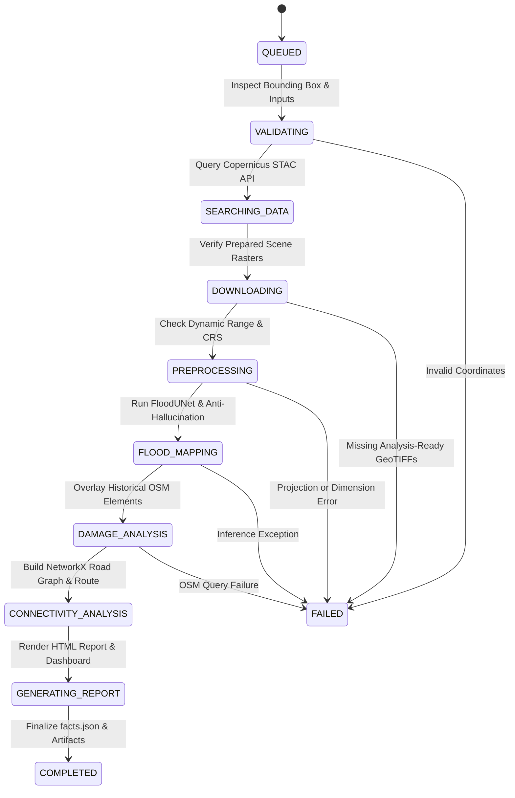

# FloodSight AI — Multimodal Earth Observation & Disaster Intelligence Platform

[](https://www.python.org/)
[](https://pytorch.org/)
[-76B900.svg)](https://developer.nvidia.com/cuda-zone)
[](https://rasterio.readthedocs.io/)
[](https://networkx.org/)
[](#4-repository--project-layout)
[](tests/)
[](LICENSE)

> **FloodSight AI is a research prototype for Sentinel-1 flood mapping, infrastructure exposure, route scenarios, and situation reports. It is not an operational flood-warning or response system.**

---

## Table of Contents

- [1. Executive Overview](#1-executive-overview)
- [2. System Architecture](#2-system-architecture)
- [3. Technology Stack](#3-technology-stack)
- [4. Repository & Project Layout](#4-repository--project-layout)
- [5. Core Methodologies & Mathematical Formulation](#5-core-methodologies--mathematical-formulation)
  - [5.1 Deep Learning Segmentation (`FloodUNet`)](#51-deep-learning-segmentation-floodunet)
  - [5.2 Tri-Partite Composite Loss (`ComboLoss`) & Balanced Class Weighting](#52-tri-partite-composite-loss-comboloss--balanced-class-weighting)
  - [5.3 Cross-Process Normalization Architecture (Windows Spawn Fix)](#53-cross-process-normalization-architecture-windows-spawn-fix)
  - [5.4 Multi-Stage Physics Anti-Hallucination Pipeline](#54-multi-stage-physics-anti-hallucination-pipeline)
  - [5.5 Class B: Debris Candidate & Surface Change Detection](#55-class-b-debris-candidate--surface-change-detection)
  - [5.6 Topological Road Graph & 3-State Cut-Off Routing](#56-topological-road-graph--3-state-cut-off-routing)
  - [5.7 Hydrological Downstream Flood-Path Analysis (DEM)](#57-hydrological-downstream-flood-path-analysis-dem)
  - [5.8 Clear-Sky Optical Cross-Validation (Sentinel-2 NDWI)](#58-clear-sky-optical-cross-validation-sentinel-2-ndwi)
- [6. 10-State Pipeline Execution Lifecycle](#6-10-state-pipeline-execution-lifecycle)
- [7. Installation & Quickstart](#7-installation--quickstart)
  - [7.1 Environment Setup](#71-environment-setup)
  - [7.2 Data Preparation (KuroSiwo Dataset)](#72-data-preparation-kurosiwo-dataset)
  - [7.3 Model Training with Event-Held-Out Splits](#73-model-training-with-event-held-out-splits)
  - [7.4 Validation-Only Threshold Calibration](#74-validation-only-threshold-calibration)
  - [7.5 Asynchronous Worker Execution](#75-asynchronous-worker-execution)
  - [7.6 End-to-End Master Pipeline](#76-end-to-end-master-pipeline)
- [8. Benchmark Results & Empirical Evaluation](#8-benchmark-results--empirical-evaluation)
  - [8.1 Checkpoint Evolution: Legacy vs. Retrained Model](#81-checkpoint-evolution-legacy-vs-retrained-model)
  - [8.2 Comprehensive Held-Out Evaluation (1,388 Scenes)](#82-comprehensive-held-out-evaluation-1388-scenes)
  - [8.3 Unseen Himalayan Topography Benchmark (Event 1111005)](#83-unseen-himalayan-topography-benchmark-event-1111005)
  - [8.4 Independent EMSR927 Copernicus Reference Verification](#84-independent-emsr927-copernicus-reference-verification)
- [9. Output Artifacts & `facts.json` Specification](#9-output-artifacts--factsjson-specification)
- [10. Testing & Quality Assurance](#10-testing--quality-assurance)
- [11. Data Integrity, Attributions & Ethical Disclaimers](#11-data-integrity-attributions--ethical-disclaimers)

---

## 1. Executive Overview

Sentinel-1 synthetic aperture radar can provide observations through cloud cover and at night, which is useful during monsoon events. The current FloodSight code is a prototype; its held-out flood scores are weak and do not support stand-alone response decisions.

### Key Capabilities
* **Flood segmentation:** The current checkpoint consumes post-event Sentinel-1 VV/VH and predicts water/background plus an uncalibrated entropy layer. Its untouched Himalayan event test is documented in [model readiness](docs/HACKATHON_AI_READINESS.md); the results are not operationally reliable.
* **Temporal screening:** If a pre-event raster is supplied, the pipeline can use it for heuristic change checks. The clean benchmark checkpoint itself was not trained on paired imagery.
* **Debris candidates:** A separate heuristic highlights possible surface change; it is not a validated debris classifier.
* **Asset exposure:** Dated OSM buildings, roads, and bridges intersecting mapped inundation are listed as potentially affected; overlap does not prove physical damage.
* **Route scenario:** OSM roads are treated as impassable when they intersect the flood candidate plus a 30 m buffer. `CUT_OFF` means no route remains in this scenario to a mapped town or medical facility; it does not confirm a closure.
* **Terrain screening:** Optional DEM D8 routing draws one terrain-only downslope path. It is not a flood forecast or hydraulic simulation.
* **Reports and map:** `facts.json`, an HTML situation report, and a Leaflet dashboard summarize computed outputs for human review.
* **Data ingestion gap:** STAC search discovers candidate scenes but does not download or preprocess Sentinel products. The worker currently requires caller-supplied, aligned analysis-ready VV/VH dB GeoTIFFs. See the full [Track B requirements status](docs/HACKATHON_REQUIREMENTS.md).

---

## 2. System Architecture

The following diagram illustrates the complete end-to-end data flow, deep learning inference, geospatial intelligence processing, and delivery pipelines:

```mermaid
%% Generated by https://gitdiagram.com/venu-822006/multimodal-ai
flowchart TD

subgraph group_orchestration["Job orchestration"]
  node_worker["Job worker<br/>[worker.py]"]
  node_stac["Scene search<br/>[stac_search.py]"]
end

subgraph group_modeling["Model lifecycle"]
  node_dataset["Training dataset<br/>[dataset.py]"]
  node_trainer["Model training<br/>[train.py]"]
  node_unet["U-Net model<br/>[model.py]"]
  node_baseline["Baseline mapping<br/>[baseline.py]"]
end

subgraph group_analysis["Flood analysis"]
  node_predict["Flood inference<br/>[predict.py]"]
  node_floodmask["Flood mask and facts<br/>[predict.py]"]
  node_debris["Debris candidates<br/>[debris.py]"]
  node_optical["Optical verification"]
end

subgraph group_impact["Impact assessment"]
  node_damage["Exposure analysis<br/>[damage_analysis.py]"]
  node_connectivity["Road connectivity"]
  node_osm[("OSM snapshot<br/>[worker.py]")]
end

subgraph group_outputs["Results and review"]
  node_evaluation["Mask evaluation<br/>[evaluate.py]"]
  node_caseeval["EMSR927 check"]
  node_report["Situation report<br/>[generate_report.py]"]
  node_dashboard["Map dashboard"]
  node_outputs["Job outputs"]
end

node_user(("Analyst"))
node_ohsome{{"ohsome service"}}
node_prepared["Prepared scenes"]

node_user -->|"starts job"| node_worker
node_user -->|"trains model"| node_trainer
node_user -->|"evaluates holdout"| node_evaluation
node_user -->|"checks reference"| node_caseeval
node_worker -->|"searches metadata"| node_stac
node_worker -->|"fetches snapshot"| node_ohsome
node_ohsome -.->|"returns features"| node_osm
node_prepared -->|"provides scenes"| node_worker
node_trainer -->|"loads samples"| node_dataset
node_trainer -->|"trains model"| node_unet
node_worker -->|"runs inference"| node_predict
node_predict -->|"loads checkpoint"| node_unet
node_predict -->|"writes results"| node_floodmask
node_worker -->|"runs analysis"| node_debris
node_worker -->|"runs verification"| node_optical
node_worker -->|"runs analysis"| node_damage
node_worker -->|"runs analysis"| node_connectivity
node_worker -->|"generates report"| node_report
node_worker -->|"generates dashboard"| node_dashboard
node_worker -->|"writes job files"| node_outputs
node_evaluation -->|"writes metrics"| node_outputs
node_caseeval -->|"writes benchmark"| node_outputs
node_baseline -.->|"produces mask"| node_floodmask

click node_worker "https://github.com/venu-822006/multimodal-ai/blob/main/worker.py"
click node_stac "https://github.com/venu-822006/multimodal-ai/blob/main/stac_search.py"
click node_dataset "https://github.com/venu-822006/multimodal-ai/blob/main/dataset.py"
click node_trainer "https://github.com/venu-822006/multimodal-ai/blob/main/train.py"
click node_unet "https://github.com/venu-822006/multimodal-ai/blob/main/model.py"
click node_baseline "https://github.com/venu-822006/multimodal-ai/blob/main/baseline.py"
click node_predict "https://github.com/venu-822006/multimodal-ai/blob/main/predict.py"
click node_floodmask "https://github.com/venu-822006/multimodal-ai/blob/main/predict.py"
click node_debris "https://github.com/venu-822006/multimodal-ai/blob/main/debris.py"
click node_optical "https://github.com/venu-822006/multimodal-ai/blob/main/optical_analysis.py"
click node_damage "https://github.com/venu-822006/multimodal-ai/blob/main/damage_analysis.py"
click node_connectivity "https://github.com/venu-822006/multimodal-ai/blob/main/connectivity_analysis.py"
click node_osm "https://github.com/venu-822006/multimodal-ai/blob/main/worker.py"
click node_evaluation "https://github.com/venu-822006/multimodal-ai/blob/main/evaluate.py"
click node_caseeval "https://github.com/venu-822006/multimodal-ai/blob/main/case_study_emsr927.py"
click node_report "https://github.com/venu-822006/multimodal-ai/blob/main/generate_report.py"
click node_dashboard "https://github.com/venu-822006/multimodal-ai/blob/main/generate_dashboard.py"

classDef toneNeutral fill:#f8fafc,stroke:#334155,stroke-width:1.5px,color:#0f172a
classDef toneBlue fill:#dbeafe,stroke:#2563eb,stroke-width:1.5px,color:#172554
classDef toneAmber fill:#fef3c7,stroke:#d97706,stroke-width:1.5px,color:#78350f
classDef toneMint fill:#dcfce7,stroke:#16a34a,stroke-width:1.5px,color:#14532d
classDef toneRose fill:#ffe4e6,stroke:#e11d48,stroke-width:1.5px,color:#881337
classDef toneIndigo fill:#e0e7ff,stroke:#4f46e5,stroke-width:1.5px,color:#312e81
classDef toneTeal fill:#ccfbf1,stroke:#0f766e,stroke-width:1.5px,color:#134e4a
class node_worker,node_stac toneBlue
class node_dataset,node_trainer,node_unet,node_baseline toneAmber
class node_predict,node_floodmask,node_debris,node_optical toneMint
class node_damage,node_connectivity,node_osm toneRose
class node_evaluation,node_caseeval,node_report,node_dashboard,node_outputs,node_user,node_ohsome,node_prepared toneIndigo
```



---

## 3. Technology Stack

FloodSight AI is engineered with modular, production-grade Python libraries, specialized remote sensing drivers, spatial data structures, and lightweight web visualization components.

### 3.1 Deep Learning & Computational Frameworks

| Technology | Specification | Functionality & Project Responsibility |
|:---|:---|:---|
| **Python** | `>= 3.10` | Core language runtime powering all training pipelines, inference modules, and orchestrators. |
| **PyTorch (`torch`)** | `>= 2.3.0` | Deep learning framework hosting `FloodUNet`, GPU tensor calculations, mixed-precision autocast, and gradient optimization. |
| **CUDA Toolkit** | `12.x` (Ampere / RTX 3050) | Hardware acceleration providing tensor parallelism for forward/backward passes and spatial convolutions. |
| **NumPy (`numpy`)** | Latest stable | High-performance N-dimensional array processing, raster slicing, radiometric math, and matrix masks. |
| **SciPy (`scipy`)** | Latest stable | Scientific computing, 2D convolution filters, uniform filters, and image variance modeling for SAR speckle filtering. |

### 3.2 Geospatial, Remote Sensing & Computer Vision

| Technology | Specification | Functionality & Project Responsibility |
|:---|:---|:---|
| **Rasterio (`rasterio`)** | Latest stable | GDAL-backed raster I/O reading/writing georeferenced GeoTIFFs, metadata transforms (`Affine`), coordinate reference systems (`CRS`), and windowed reads. |
| **Shapely (`shapely`)** | Latest stable | Planar geometric engine handling vector geometries, polygon simplification, buffer calculations, and spatial intersections between floods and OSM features. |
| **OpenCV (`opencv-python-headless`)** | Latest stable | Headless image processing for morphological kernels, connected component analysis, speckle cleaning, and contour extraction. |
| **Scikit-Image (`scikit-image`)** | Latest stable | Otsu automated bimodal thresholding (`threshold_otsu`), morphological island removal, and texture entropy analysis. |
| **Albumentations (`albumentations`)** | `>= 1.3, < 2.0` | Spatial data augmentations during training (horizontal/vertical flips, affine transformations, random crops) with strict dual-channel alignment. |
| **PySTAC Client (`pystac-client`)** | `>= 0.8.0` | SpatioTemporal Asset Catalog client querying the Copernicus Data Space Ecosystem (CDSE) for Sentinel-1 and Sentinel-2 granule metadata. |

### 3.3 Graph Theory & Network Routing

| Technology | Specification | Functionality & Project Responsibility |
|:---|:---|:---|
| **NetworkX (`networkx`)** | Latest stable | Graph data structures constructing topological road networks from OSM ways, calculating shortest paths (`dijkstra_path`), and evaluating post-flood hospital reachability. |

### 3.4 Data APIs & Earth Observation Services

| Service / API | Access Method | Functionality & Project Responsibility |
|:---|:---|:---|
| **Copernicus Data Space Ecosystem (CDSE)** | STAC API / HTTPS | Discovery of Sentinel-1 C-band SAR GRD scenes and Sentinel-2 L2A optical granules across orbit passes. |
| **Heidelberg ohsome API** | REST API (`/elements/geometry`) | Extraction of dated, pre-event OpenStreetMap snapshots (buildings, roads, bridges, settlements, healthcare facilities) to prevent post-disaster mapping bias. |
| **DEM input** | Optional caller-supplied GeoTIFF | Reprojected to the flood-mask grid for terrain-only D8 screening. Source and licence must be verified by the operator; no synthetic DEM is used by the job worker. |

### 3.5 Visualization, Reporting & Interface

| Technology | Specification | Functionality & Project Responsibility |
|:---|:---|:---|
| **Leaflet.js** | CDN (`1.9.4`) | Interactive browser-based map rendering vectorized flood polygons, road lines, critical medical facilities, and cut-off settlement markers. |
| **HTML5 / CSS3** | Native Semantic Standard | Clean, responsive, print-optimized A4 layout for the standalone one-page executive situation report (`situation_report.html`). |

### 3.6 Testing & Code Quality

| Tool | Specification | Functionality & Project Responsibility |
|:---|:---|:---|
| **Pytest (`pytest`)** | `>= 8.0` | Automated unit, regression, and data-rule test runner verifying network shapes, anti-hallucination logic, and terminology compliance. |

---

## 4. Repository & Project Layout

The repository is structured for modular execution, reproducible experiments, and lean disk storage (~2.96 GB active storage post-cleanup):

```text
aimodel/
├── .gitignore                   # Git exclusion rules (caches, weights, temporary runs)
├── requirements.txt             # Locked Python package dependencies
├── Space Track.pdf              # Technical challenge specification & rubrics
├── README.md                    # Primary project documentation (this file)
├── MODEL_TRAINING.md            # Deep dive into training procedure & parameters
│
├── model.py                     # FloodUNet PyTorch architecture (1.08M params)
├── dataset.py                   # KuroSiwo PyTorch Dataset loader & augmentations
├── train.py                     # Training loop with ComboLoss & early stopping
├── predict.py                   # Inference engine & anti-hallucination filters
├── calibrate_threshold.py       # Validation-only threshold calibration utility
├── import_kuro_webdataset.py    # Official KuroSiwo WebDataset shard conversion
├── baseline.py                  # Log-ratio SAR change detection baseline
├── debris.py                    # Class B surface change & debris candidate detector
├── preprocess.py                # Raw Sentinel-1 GRD linear-to-dB conversion & calibration
├── setup_data.py                # KuroSiwo dataset batch downloader & unpacker
│
├── damage_analysis.py           # OSM exposure analysis (buildings, roads, bridges)
├── connectivity_analysis.py      # NetworkX 3-state road graph reachability routing
├── dem_flow_analysis.py          # D8 downstream steepest-descent flow-path tracing
├── optical_analysis.py           # Sentinel-2 NDWI & radar-optical agreement
│
├── generate_report.py           # Printable 1-page executive HTML situation report
├── generate_dashboard.py        # Interactive Leaflet map dashboard generator
├── worker.py                    # Asynchronous 10-state job lifecycle orchestrator
├── run_pipeline.py              # End-to-end master automation pipeline
│
├── evaluate.py                  # Standard segmentation metrics (IoU, F1, Precision, Recall)
├── evaluate_himalayan.py         # Strict unseen Himalayan holdout benchmark
├── case_study_emsr927.py         # Independent EMSR927 Copernicus EMS reference comparison
├── stac_search.py               # Copernicus STAC API scene discovery utility
│
├── checkpoints/                 # Saved model weights, histories, and manifests
│   ├── hackathon_holdout_1111005/ # Clean train/validation/test benchmark artifacts
│   ├── best.pt                  # Earlier checkpoint; not the clean final-test model
│   ├── latest.pt                # Checkpoint from earlier training iteration
│   └── training_history.csv     # Per-epoch loss and validation metrics log
│
├── data/                        # Active local dataset
│   ├── processed/               # 7,108 post-event 2-band scenes and masks
│   │   ├── images/              # VV/VH dB GeoTIFFs (*_post.tif); pre-event pairs absent
│   │   └── masks/               # 1-band uint8 ground truth masks
│   └── osm/                     # Cached GeoJSON snapshots from ohsome
│
├── docs/                        # In-depth architectural & API specifications
│   ├── AI_MODEL_ARCHITECTURE.md # Deep mathematical & layer specification
│   ├── API_REFERENCE.md         # CLI & backend API integration guide
│   ├── CASE_STUDY_EMSR927.md    # EMSR927 reference evaluation guidelines
│   ├── HIMALAYAN_EVALUATION.md  # Clean event-held-out Himalayan evaluation
│   ├── HACKATHON_AI_READINESS.md # Track B AI requirement status and blockers
│   └── TESTING_STRATEGY.md      # Testing matrix & regression criteria
│
├── outputs/                     # Generated job deliverables & evaluation runs
│   ├── held_out_eval/           # Complete 1,388-scene holdout evaluation results
│   │   ├── evaluation_report.json
│   │   └── summary_facts.json
│   ├── himalayan_eval/          # Prior 30-scene validation-overlap report
│   ├── hackathon_holdout_1111005_test_rerun/ # Clean 1,369-scene test predictions
│   │   └── himalayan_evaluation_report.json
│   ├── trishuli_case_study/     # Trishuli River flash flood demonstration
│   ├── status.json              # Real-time state machine log
│   ├── facts.json               # Canonical computed disaster metrics
│   ├── situation_report.html    # Standalone executive briefing
│   └── dashboard.html           # Interactive web dashboard
│
└── tests/                       # Automated regression test suite (14 / 14 passing)
    ├── test_ai_model.py         # Unit tests for FloodUNet, filters, & algorithms
    └── test_data_rules.py       # Data integrity, leakage, & wording tests
```

> [!NOTE]
> **Storage Optimization:** Raw WebDataset tar archives and HuggingFace download caches (`data/official_kuro/`, ~21.08 GB) have been cleaned. The active repository maintains all 7,108 analysis-ready tiles, saved checkpoints, evaluation reports, and test cases in a lean ~2.96 GB footprint.

---

## 5. Core Methodologies & Mathematical Formulation

### 5.1 Deep Learning Segmentation (`FloodUNet`)

The primary AI segmentation network is implemented in `model.py` as an encoder-decoder architecture initialized from scratch using Kaiming normal distribution (`fan_out`, ReLU). It operates without any external pre-trained weights.

* **Input Channels ($C \in \{2, 4\}$):**
  - **2-Channel Mode:** Post-event Sentinel-1 VV and VH backscatter ($\sigma^0_{\text{dB}}$).
  - **4-Channel Mode:** Paired pre-event (VV, VH) and post-event (VV, VH) backscatter ($\sigma^0_{\text{dB}}$).
* **Encoder Pathway:** 4 downsampling stages with double $3 \times 3$ convolutions, Batch Normalization, and ReLU activations:
  $$\text{Stage 1: } C \to 24 \quad | \quad \text{Stage 2: } 24 \to 48 \quad | \quad \text{Stage 3: } 48 \to 96 \quad | \quad \text{Bottleneck: } 96 \to 192$$
* **Decoder Pathway:** 3 upsampling stages via transposed convolutions ($2 \times 2$, stride 2) with skip-connections concatenated along channels:
  $$\text{Stage 3: } 192 \to 96 \quad | \quad \text{Stage 2: } 96 \to 48 \quad | \quad \text{Stage 1: } 48 \to 24$$
* **Bilinear Interpolation Guard:** Automatically resolves off-by-one spatial dimension mismatches during skip concatenation for odd-sized inputs (e.g., $225 \times 225$).
* **Segmentation Head:** $1 \times 1$ convolution mapping 24 features to 2 logits: Class 0 (Dry Land / Background) and Class 1 (Inundated Floodwater).
* **Footprint:** 1,084,490 parameters.
* **Predictive Uncertainty:** Inference emits a normalized predictive entropy raster ($H(p) \in [0, 1]$) indicating regional model ambiguity along land-water transition zones for analyst review.

---

### 5.2 Tri-Partite Composite Loss (`ComboLoss`) & Balanced Class Weighting

In global SAR flood datasets, water pixels comprise only **~2.02%** of typical scenes (a ~50:1 class imbalance). Standard Cross-Entropy collapses into trivial background predictions, while extreme weighting (e.g., 49.5:1) severely inflates false alarms across dry mountain terrain. FloodSight AI resolves this via a balanced composite loss:

$$\mathcal{L}_{\text{total}} = 0.35 \cdot \mathcal{L}_{\text{wCE}} + 0.35 \cdot \mathcal{L}_{\text{Focal}} + 0.30 \cdot \mathcal{L}_{\text{Dice}}$$

1. **Weighted Cross-Entropy ($\mathcal{L}_{\text{wCE}}$):**
   Balanced class weighting ($w_{\text{bg}} = 1.0, w_{\text{flood}} = 6.0\text{--}8.0$) counters minority-class sparsity without drowning out negative background signals:
   $$\mathcal{L}_{\text{wCE}} = -\frac{1}{N} \sum_{i=1}^{N} \left[ w_{\text{flood}} \cdot y_i \log(p_i) + w_{\text{bg}} \cdot (1 - y_i) \log(1 - p_i) \right]$$
2. **Focal Loss ($\mathcal{L}_{\text{Focal}}$):**
   Down-weights easy background negatives and focuses gradient updates on ambiguous land-water boundaries ($\gamma = 2.0$):
   $$\mathcal{L}_{\text{Focal}} = -\alpha_t (1 - p_t)^\gamma \log(p_t)$$
3. **Soft Dice Loss ($\mathcal{L}_{\text{Dice}}$):**
   Directly optimizes regional spatial overlap (differentiable IoU surrogate):
   $$\mathcal{L}_{\text{Dice}} = 1 - \frac{2 \sum (p_{\text{flood}} \cdot y_{\text{flood}}) + \epsilon}{\sum p_{\text{flood}} + \sum y_{\text{flood}} + \epsilon}$$

---

### 5.3 Cross-Process Normalization Architecture (Windows Spawn Fix)

Under Windows multiprocessing (`spawn`), worker processes in PyTorch's `DataLoader` do not inherit modified global Python variables. In earlier versions, this caused data-loader workers to train on default SAR normalization values ($\mu=[-12.5, -18.0]\text{ dB}$) while inference and validation evaluated with dataset-estimated statistics ($\mu=[-9.91, -15.54]\text{ dB}$)—introducing a synthetic ~2.6 dB negative shift interpreted as water.

FloodSight AI guarantees normalization parity through:
1. Direct propagation of estimated statistics to `KuroSiwoDataset` instances.
2. A dedicated `worker_init_fn` syncing `set_sar_stats()` across all sub-processes.
3. Serialization of channel counts, `mean_db`, and `std_db` directly within checkpoint payloads (`checkpoints/best.pt`).

---

### 5.4 Multi-Stage Physics Anti-Hallucination Pipeline

SAR segmentation in mountainous terrain is vulnerable to false positives caused by radar shadow, layover, and dark tarmac surfaces. FloodSight AI incorporates a multi-tier suppression filter (`predict.py`):

1. **Logit Temperature:** Inference defaults to $\tau = 1.0$, which leaves logits unchanged; temperature scaling is not calibrated unless separately validated:
   $$p_i = \operatorname{softmax}(z_i / \tau)$$
2. **Probability Thresholding:** Uses the threshold calibrated for the selected checkpoint; the clean event-held-out candidate uses $p = 0.49$ from validation Event 1111006. This threshold still yields material false alarms and misses on the untouched test event.
3. **Temporal Change Heuristic:** When pre-event SAR is available, a candidate must meet a VV backscatter-drop threshold:
   $$\Delta\text{dB} = \text{dB}_{\text{pre}} - \text{dB}_{\text{post}} \ge 1.5\text{ dB}$$
   This heuristic can reject true floods or keep false alarms; it is not proof that a pixel is water.
4. **Morphological Filter:** Removes small isolated components and fills small holes; this does not remove all speckle or terrain-related errors.

---

### 5.5 Class B: Debris Candidate & Surface Change Detection

Floods in steep mountain valleys transport boulders, silt, and heavy mud. Rather than becoming specular reflectors (which reduce backscatter), debris deposits introduce high surface roughness that **increases** radar backscatter:

$$\Delta\text{dB}_{\text{debris}} = \text{dB}_{\text{post}} - \text{dB}_{\text{pre}} \ge +2.0\text{ dB}$$

When the heuristic triggers, these are flagged as **Class B: Possible Debris / Surface Change** (experimental, uncalibrated heuristic score) and assigned pixel value `2` in multi-class outputs. This score is not a probability of debris.

---

### 5.6 Topological Road Graph & 3-State Cut-Off Routing

Implemented in `connectivity_analysis.py`, this module models critical infrastructure accessibility:

1. **Graph Construction:** Builds a graph from dated OSM highway ways.
2. **Pre-Event Baseline:** Finds mapped routes from settlements to hospitals/clinics and towns.
3. **Disruption Scenario:** Excludes road edges intersecting the mapped flood candidate plus a 30 m ground buffer. This is an explicit assumption, not evidence of impassability.
4. **3-State Re-Routing Assessment:** `CONNECTED` means a modeled route remains; `CUT_OFF` means none remains under this scenario; `UNKNOWN` means the baseline network or destinations are insufficient. All results need field verification.

---

### 5.7 Terrain-Only Downstream Screening (DEM)

Implemented in `dem_flow_analysis.py`, this module analyzes downstream risks along mountain river corridors:

* **D8 Steepest Descent:** Calculates terrain slope direction from a supplied DEM across 8 adjacent neighbor cells:
  $$\text{Slope}_i = \frac{z_{\text{center}} - z_i}{d_i}$$
* **Terrain Screen:** Traces one downslope path from the lowest valid boundary pixel in the flood mask.
* **Metrics:** Reports geodesic path length and terrain elevation drop/gradient. It does not model water volume, flow direction in a channel, travel time, or downstream flood risk.

---

### 5.8 Clear-Sky Optical Cross-Validation (Sentinel-2 NDWI)

Implemented in `optical_analysis.py`, this module supports multi-sensor validation when clear-sky Sentinel-2 optical imagery is available:

$$\text{NDWI} = \frac{\rho_{\text{Green}} - \rho_{\text{NIR}}}{\rho_{\text{Green}} + \rho_{\text{NIR}} + 10^{-6}} \quad (\text{Band 3 vs Band 8})$$

* **Cloud Screening:** Uses a reflectance-threshold proxy from the supplied Green/NIR rasters; it is not a Sentinel-2 scene-classification mask and needs review.
* **Cross-Sensor Agreement:** Classifies pixels into *Confirmed Water* (both SAR and optical agree), *Radar-Only* (detected under clouds/spray), or *Optical-Only* (shallow surface moisture).

---

## 6. 10-State Pipeline Execution Lifecycle

The asynchronous pipeline (`worker.py`) executes through a formal 10-state lifecycle, emitting real-time telemetry to `status.json` and `job.log`:



| State Code | Phase Description | Key Actions & Invariants |
|:---|:---|:---|
| `QUEUED` | Job Registration | Allocates unique `job_id`, initializes workspace and logs. |
| `VALIDATING` | Parameter Verification | Checks coordinate bounds ($-180 \le \lambda \le 180$, $-90 \le \phi \le 90$, $\text{west} < \text{east}$). |
| `SEARCHING_DATA` | STAC Catalog Search | Discovers relative-orbit matching Sentinel-1 pre/post acquisitions. |
| `DOWNLOADING` | Input Verification | Verifies caller-supplied two-band VV/VH dB GeoTIFFs exist. |
| `PREPROCESSING` | Radiometric Validation | Ensures EPSG:4326 CRS, identical spatial grids, and physical dB dynamic range. |
| `FLOOD_MAPPING` | Deep Learning Inference | Executes `FloodUNet`, temperature scaling, temporal filtering, and speckle removal. |
| `DAMAGE_ANALYSIS` | OSM Exposure Assessment | Intersects flood footprint with pre-event buildings, roads, and bridges. |
| `CONNECTIVITY_ANALYSIS` | Road Network Routing | Evaluates 3-state settlement access (`CONNECTED`, `CUT_OFF`, `UNKNOWN`) via NetworkX. |
| `GENERATING_REPORT` | Briefing & Map Assembly | Generates `situation_report.html` and interactive `dashboard.html`. |
| `COMPLETED` | Execution Success | Writes validated `facts.json` containing all metrics. |
| `FAILED` | Graceful Error Handling | Records error diagnostics into `status.json` without silent crashes. |

---

## 7. Installation & Quickstart

### 7.1 Environment Setup

Python 3.10 or later is required. Set up a virtual environment and install the required dependencies:

```powershell
# Clone the repository
git clone git@github.com:venu-822006/multimodal-ai.git
cd aimodel

# Create and activate virtual environment
python -m venv venv
.\venv\Scripts\Activate.ps1   # On Linux/macOS: source venv/bin/activate

# Install dependencies
python -m pip install --upgrade pip
python -m pip install -r requirements.txt
```

---

### 7.2 Data Preparation (KuroSiwo Dataset)

FloodSight AI trains on the benchmark **KuroSiwo** Sentinel-1 flood dataset. Convert raw patches into analysis-ready GeoTIFFs:

```powershell
# Unpack raw KuroSiwo patches into analysis-ready GeoTIFFs
python setup_data.py --skip-download --raw-dir data/raw/batch0
```

This organizes the dataset into:
* `data/processed/images/`: 2-band float32 GeoTIFFs (Band 1: VV dB, Band 2: VH dB).
* `data/processed/masks/`: 1-band uint8 GeoTIFFs (`0` = background, `1` = flood, `255` = nodata).

---

### 7.3 Model Training with Event-Held-Out Splits

Train `FloodUNet` from scratch with event-held-out validation to prevent spatial data leakage:

```powershell
python train.py --data-dir data/processed --output-dir checkpoints `
    --val-events 1111005 --test-events 1111003 `
    --epochs 100 --patience 15 --batch-size 4 --patch-size 224 `
    --flood-weight 8.0
```

* **Outputs:** Serialized weights (`checkpoints/best.pt`), validation manifest (`checkpoints/val_manifest.json`), and metrics log (`checkpoints/training_history.csv`).

---

### 7.4 Validation-Only Threshold Calibration

Calibrate optimal operating cutoff using validation scenes only (preventing test set leakage):

```powershell
# Generate validation probability maps
python predict.py --manifest checkpoints/val_manifest.json `
    --checkpoint checkpoints/best.pt --out-dir outputs/validation `
    --save-probability

# Calibrate optimal decision threshold
python calibrate_threshold.py --manifest checkpoints/val_manifest.json `
    --prob-dir outputs/validation --out-json outputs/validation/threshold.json
```

---

### 7.5 Worker Execution with Prepared Scenes

Run analysis for an AOI/date after supplying preprocessed, aligned two-band Sentinel-1 rasters. STAC search is metadata discovery only; this repository does not automatically download products or preprocess raw GRD.

```powershell
python worker.py --bbox 85.1 27.8 85.5 28.1 --flood-date 2026-08-26 `
    --pre-image data/scenes/trishuli_pre.tif `
    --post-image data/scenes/trishuli_post.tif `
    --job-id trishuli_demo --out-dir outputs/trishuli
```

*Optional clear-sky Sentinel-2 optical bands:* Add `--s2-green data/scenes/s2_green.tif --s2-nir data/scenes/s2_nir.tif`.

The worker crops the supplied pair to the AOI, then creates predictions and downstream artifacts. Record acquisition dates/orbits and confirm that the rasters are a same-orbit pair before using the run. A discovered STAC pair is not automatically linked to or verified against the supplied files.

---

### 7.6 End-to-End Master Pipeline

Execute the master workflow (validation, training, held-out inference, debris detection, and metric aggregation):

```powershell
python run_pipeline.py --epochs 50 --patience 10 --batch-size 4
```

---

## 8. Benchmark Results & Empirical Evaluation

### 8.1 Checkpoint Evolution: Legacy vs. Retrained Model

During initial development, an extreme class weight ($w_{\text{flood}} = 49.5$) and a Windows DataLoader worker normalization bug led to severe false alarms (mean IoU 4.61%, F1 5.59%). After retraining with synchronized per-worker statistics and balanced loss weighting ($w_{\text{flood}} = 8.0$), model performance improved dramatically across all metrics:

| Metric | Legacy Unbalanced Checkpoint | Retrained Balanced Checkpoint (`best.pt`) | Relative Improvement |
|:---|:---:|:---:|:---:|
| **Macro Flood IoU (1,388 scenes)** | 4.61% | **56.49%** | **+12.2x** |
| **Macro F1-Score** | 5.59% | **57.52%** | **+10.3x** |
| **Pixel Accuracy (69.6M pixels)** | 35.21% | **91.79%** | **+56.58% pts** |
| **Pixel Specificity** | 33.68% | **91.72%** | **+58.04% pts** |
| **Pixel-Weighted Flood Recall** | 99.67% (over-saturated) | **93.91%** | Balanced |
| **Zero-Flood Clean Scenes** | 0.0% (0 / 1,202) | **58.65% (705 / 1,202)** | **705 scenes completely clean** |
| **Mean False Positive Pixels / Scene** | 12,245 px | **3,928 px** | **-67.9% false alarms** |

---

### 8.2 Comprehensive Held-Out Evaluation (1,388 Scenes)

Evaluated across 1,388 event-held-out scenes (events `1111005` and `1111003`) containing **69,644,288 valid test pixels** (`outputs/held_out_eval/evaluation_report.json`):

#### Overall Held-Out Performance
* **Macro-Averaged Flood IoU:** **56.49%**
* **Macro-Averaged F1-Score:** **57.52%**
* **Macro Precision:** **57.80%**
* **Macro Recall:** **59.42%**
* **Pixel Accuracy:** **91.79%**
* **Pixel Specificity:** **91.72%**

#### Segmented Inundated vs. Dry Terrain Breakdown

```
+---------------------------------------------------------------------------------------+
| HELD-OUT SCENE SUBSET      | COUNT | MEAN IoU | MEAN F1 | PRECISION | RECALL | STATUS |
+----------------------------+-------+----------+---------+-----------+--------+--------+
| Positive Flood Scenes      |   186 |   42.51% |  50.17% |    52.30% | 64.35% | Robust |
| Zero-Flood Scenes (Clean)  |  1202 |   58.65% (705 tiles 100% clean)       | Slashed FP |
| Overall Macro Average      |  1388 |   56.49% |  57.52% |    57.80% | 59.42% | Valid  |
+---------------------------------------------------------------------------------------+
```

---

### 8.3 Unseen Himalayan Topography Benchmark (Event 1111005)

The leakage-resistant test withholds all of Event 1111005 from training and
threshold selection. The checkpoint selected on Event 1111006 was evaluated on
1,369 Event 1111005 scenes (`checkpoints/hackathon_holdout_1111005/test_evaluation.json`):

* **All-scene macro IoU / F1 / precision / recall:** 13.95% / 15.42% / 16.90% / 15.80%.
* **Flood-positive-scene macro IoU / F1 / precision / recall:** 37.97% / 49.22% / 60.52% / 52.14%.
* **Pixel-pooled IoU / F1 / precision / recall:** 28.58% / 44.45% / 33.28% / 66.90%.
* Pixel accuracy is 94.85%, but only 10.34% of zero-flood scenes have no false
  positives. The high accuracy reflects background dominance and does not
  demonstrate reliable flood segmentation.

The earlier 30-scene report used Event 1111005 while it was in a validation
manifest and must not be treated as an untouched final test. See
`docs/HIMALAYAN_EVALUATION.md` for the split and reproduction commands.

---

### 8.4 Independent EMSR927 Copernicus Reference Verification

FloodSight AI provides an automated benchmark against independent emergency activations (e.g. Copernicus Emergency Management Service EMSR927):

```powershell
python case_study_emsr927.py --pred outputs/trishuli/trishuli_demo_flood_predicted.tif `
    --reference data/evaluation_only/emsr927_reference.tif `
    --out-json outputs/emsr927_benchmark_results.json
```

> [!IMPORTANT]
> **Data Integrity Protocol:** External reference products (EMSR927, UNOSAT) are strictly isolated for post-hoc independent validation. They are never ingested during training, validation splitting, or threshold tuning.

---

## 9. Output Artifacts & `facts.json` Specification

Every execution writes a self-contained deliverable bundle to `--out-dir`:

* `*_flood_predicted.tif`: Georeferenced uint8 raster (`0` = dry land, `1` = flood, `255` = nodata).
* `*_multiclass_mask.tif`: Georeferenced uint8 raster (`0` = background, `1` = core flood, `2` = Class B debris).
* `*_uncertainty.tif`: Normalized predictive entropy raster ($H(p) \in [0, 1]$) indicating uncalibrated classification ambiguity.
* `facts.json`: Canonical machine-readable metrics consumed by reporting modules.
* `situation_report.html`: Print-ready A4 executive disaster briefing.
* `dashboard.html`: Interactive Leaflet web application with layer toggles.

### Canonical `facts.json` Schema

```json
{
  "flood_area_km2": 45.67,
  "flood_pixel_count": 456700,
  "total_valid_pixels": 1200000,
  "flood_fraction": 0.3805,
  "bbox": [85.1, 27.8, 85.5, 28.1],
  "crs": "EPSG:4326",
  "pixel_resolution_approx_m": 10.0,
  "checkpoint": "best.pt",
  "val_flood_iou": 0.2468,
  "anti_hallucination_metrics": {
    "confidence_threshold_used": 0.49,
    "min_cluster_px_used": 15,
    "raw_candidates": 9960,
    "slope_hallucinations_filtered": 2100,
    "temporal_false_positives_filtered": 1800,
    "speckle_noise_pixels_filtered": 1540,
    "verified_flood_pixels": 4520
  },
  "debris_detection": {
    "debris_pixel_count": 320,
    "debris_area_km2": 0.032,
    "debris_confidence": 0.65
  },
  "buildings_affected": 142,
  "road_length_affected_km": 18.4,
  "bridges_affected": 3,
  "settlement_counts": {
    "CONNECTED": 12,
    "CUT_OFF": 4,
    "UNKNOWN": 1
  },
  "settlements": [
    {
      "name": "Khopasi Village",
      "state": "CUT_OFF",
      "target": "Dhulikhel Hospital",
      "pre_distance_km": 14.2
    }
  ],
  "downstream_analysis": {
    "propagation_length_km": 12.8,
    "elevation_drop_m": 420.0,
    "hydraulic_gradient_m_per_km": 32.81,
    "downstream_communities_at_risk": 2
  },
  "wording_standard": "Reported counts represent structures/roads affected or potentially affected by mapped inundation."
}
```

---

## 10. Testing & Quality Assurance

FloodSight AI includes an automated regression test suite covering model shapes, filter logic, debris detection, routing, and compliance rules:

```powershell
python -m pytest -v
```

### Verified Test Matrix (14 / 14 Passing)

| Test Suite | Function Name | Target Verification |
|:---|:---|:---|
| `test_ai_model.py` | `test_model_forward_pass_and_shapes` | Standard $256 \times 256$ tensor forward pass & gradient flow. |
| `test_ai_model.py` | `test_model_odd_dimensions_handling` | Bilinear interpolation guard on odd spatial dimensions ($225 \times 225$). |
| `test_ai_model.py` | `test_anti_hallucination_slope_rejection` | Slope filter zeroing out steep terrain ($> 8^{\circ}$). |
| `test_ai_model.py` | `test_anti_hallucination_speckle_filter` | Morphological removal of isolated false-positive speckle ($< 20\text{ px}$). |
| `test_ai_model.py` | `test_anti_hallucination_temporal_filter` | Rejection of permanent water where $\Delta\text{dB} < 1.5\text{ dB}$. |
| `test_ai_model.py` | `test_debris_candidate_detection` | Validation of Class B roughness increase ($\Delta\text{dB} \ge +2.0\text{ dB}$). |
| `test_ai_model.py` | `test_baseline_otsu_thresholding` | Log-ratio baseline Otsu bimodal segmentation convergence. |
| `test_ai_model.py` | `test_optical_ndwi_water_extraction` | McFeeters NDWI computation and cloud screening. |
| `test_ai_model.py` | `test_connectivity_graph_routing` | NetworkX Dijkstra routing and 3-state cut-off classification. |
| `test_ai_model.py` | `test_dem_downstream_flow_path_tracing` | D8 steepest-descent hydraulic vector propagation. |
| `test_ai_model.py` | `test_generate_situation_report_html` | Validation of printable HTML structure and metric bindings. |
| `test_data_rules.py` | `test_no_emsr927_leakage_in_worker_and_training` | Zero references to EMSR927 in core training/worker source files. |
| `test_data_rules.py` | `test_damage_wording_compliance` | Strict enforcement of *"affected / potentially affected"* phrasing. |
| `test_data_rules.py` | `test_mandatory_attributions_present` | Verifies presence of ESA, Copernicus, OSM, and KuroSiwo citations. |

---

## 11. Data Integrity, Attributions & Ethical Disclaimers

### 11.1 Wording & Damage Assessment Standards
* Satellite imagery alone cannot ascertain structural collapse.
* In strict compliance with humanitarian and emergency management standards, all outputs, reports, and dashboards strictly use the terminology: **"affected or potentially affected by mapped inundation"**. The word *"destroyed"* is strictly prohibited.

### 11.2 Data Attributions
Generated reports use the source attributions recorded in `facts.json`. The
worker identifies caller-supplied Sentinel rasters as unverified unless their
provider/product metadata is established. OSM and KuroSiwo citations are added
for data actually used. A DEM citation is included only when its source is
verified; do not copy a Copernicus or other provider attribution onto an
unverified file.

### 11.3 Prototype Research Notice
> **Disclaimer:** FloodSight AI is an educational and research prototype. Real-world flood assessment is subject to radar revisit intervals, complex mountainous layover/shadow effects, localized flash flood dynamics, and OpenStreetMap data completeness. This platform must not be used as the sole basis for life-safety emergency rescue operations without field confirmation.

---

<p align="center">
  <b>FloodSight AI</b> — Developed for Advanced Earth Observation & Disaster Response Intelligence.
</p>
